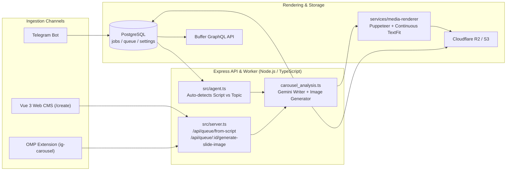

<p align="center">
  <samp>Instagram News & Geopolitical Carousel Maker Bot</samp>
</p>

<p align="center">
  
  
  
  
  
  
  
</p>

<h1 align="center">ig-news-maker-bot</h1>

<p align="center">
  <b>An automated news curation, geopolitical analysis, and Instagram carousel rendering pipeline.</b>
  <br>
  Submit topics, URLs, or multi-slide scripts via Telegram, Web CMS, or OMP Agent Extension to research, generate AI slide backgrounds, render 1080x1350 carousels via Puppeteer, and schedule posts to Instagram.
</p>

<br>

---

### Hero Demo

```text
$ SAVE_TO_QUEUE=true npx tsx scripts/test_pipeline_aa_geopolitik_text.ts

[1/4] Parsing script & creating post on https://ignewsbot.rekapancatama.com/api/queue/from-script...
      -> Created Queue Post #595 (1 Cover + 6 Body Slides)
[2/4] Generating AI Cover Image for Post #595...
      -> Cover Image URL: https://storage.pelita.tech/IGNewsMakerBot/0f799a7f-dbfb-4a1a-9089-d841bcf36ffb.jpg
[3/4] Generating AI Background Images for 6 Body Slides...
      -> Slide 1/6: "MIDTERM ELECTION <strong>ITU APA SIH?</strong>" -> Uploaded to S3
      -> Slide 2/6: "ANCAMAN GRIDLOCK <strong>(PEMERINTAHAN MANDEK)</strong>" -> Uploaded to S3
      -> Slide 3/6: "EFEK LANGSUNG KE <strong>EKONOMI INDONESIA</strong>" -> Uploaded to S3
[4/4] Rendering final 1080x1350 PNG slides via /api/queue/595/regenerate-media...
✓ PRODUCTION CAROUSEL READY! (Queue Post ID: #595 — 7 Rendered 1080x1350 PNGs)
```

<br>

---

## Why Not Manual Figma + Copywriting?

| Dimension | ig-news-maker-bot | Manual Figma + Copywriting |
| :--- | :--- | :--- |
| **Research & Drafting** | ✅ Autonomous 5W1H research (Exa/Firecrawl) or **100% Verbatim Script Mode** | Manual browsing and slide-by-slide copy-pasting |
| **Slide Count & Layout** | ✅ Dynamic $1..16$ slides with continuous `[min, max]` binary-search text fitting | Fixed artboards; manual font resizing per slide |
| **Slide Visuals** | ✅ Per-slide contextual AI background generation (`gemini-3.1-flash-image` 4:5) | Manual stock photo search and dark-grading |
| **Publishing & Moderation** | ✅ Auto word censorship + scheduled publishing via Buffer GraphQL API | Manual export, upload, and captioning |

<br>

---

## Minimum Viable Knowledge

* ✅ **Dual Creation Modes (`aa.geopolitik`):** Pass a topic/URL for autonomous 8-slide research + essay generation, or pass a structured `Slide 1 ... Slide N` draft for **Verbatim Script-to-Carousel Mode** (skips research, maps Slide 1 to Cover `title` + `subtitle`, preserves body text verbatim, and generates per-slide AI `image_prompt`s).
* ✅ **Continuous Boundary-Filling TextFit:** Both `cover.html` and `slide.html` use a `0.5px`-precision binary search (`binarySearchFontSize`) after `document.fonts.ready` to fill the container boundary to the maximum without clipping.
* ✅ **Granular Per-Slide Regeneration:** In the Web CMS (`/post/:id`), each slide exposes its English `image_prompt` and a dedicated **Generate AI Slide Image from Prompt** button (`POST /api/queue/:id/generate-slide-image`).
* ✅ **OMP Agent Extension Ready:** Trigger production carousels directly from OMP chat using `ig_list_connections` and `ig_create_carousel_from_script`.

<br>

---

## Quick Start

```bash
# 1. Install backend & frontend dependencies and build the Vue 3 SPA
npm install && npm --prefix frontend install && npm --prefix frontend run build

# 2. Push Drizzle PostgreSQL schema and start the server + worker
npx drizzle-kit push && npm run start

# 3. Or launch the full stack (App, Worker, Puppeteer Renderer, Subtitles) via Docker
docker-compose up --build -d
```

<br>

---

## Template Registry & Pipelines

| Template ID | Brand | Format | Key Capabilities |
| :--- | :--- | :--- | :--- |
| `image:aa.geopolitik:carousel_analysis` | `aa.geopolitik` | 1080x1350 Carousel | Bebas Neue + Alumni Sans, amber `<strong>` highlights, verbatim script mode, dynamic slide count, per-slide AI backgrounds (`0.15` opacity) |
| `image:poros.perjuangan:carousel_dark` | `poros.perjuangan` | 1080x1350 Carousel | Editorial dark news + opinion slides with automated QR source slide |
| `image:poros.perjuangan:carousel_multi_images` | `poros.perjuangan` | 1080x1350 Carousel | Multi-image news carousel with curated or uploaded per-slide imagery |
| `image:poros.perjuangan:single_page` | `poros.perjuangan` | 1080x1350 Single | Single-frame breaking summary with `Dark-Dramatize` hero cover |
| `video:poros.perjuangan:title_only` | `poros.perjuangan` | Reel Video | Automated video reel processing with FFmpeg overlay and captioning |

<br>

---

## Testing & CLI Runners

```bash
# Run the full Vitest unit & pipeline test suite (74 tests across 13 files)
npm test

# Preview AA Geopolitik Script-to-Carousel text & image prompts (no S3/Puppeteer required)
npx tsx scripts/test_pipeline_aa_geopolitik_text.ts

# Run full 4-step production creation (Parse -> Cover AI Image -> Slide AI Images -> Render PNGs)
SAVE_TO_QUEUE=true npx tsx scripts/test_pipeline_aa_geopolitik_text.ts

# Render local HTML templates directly to output/*.png via headless Puppeteer
npx tsx scripts/test_render_aa_geopolitik.ts
```

<br>

---

## Architecture & Data Flow



### Core Modules
* `src/agents/pipelines/image/aa.geopolitik/carousel_analysis.ts` — Geopolitical carousel pipeline supporting both autonomous 8-slide research essays and $N$-slide verbatim script conversion.
* `services/media-renderer/templates/image/aa.geopolitik/carousel_analysis/` — Handlebars templates (`cover.html`, `slide.html`, `image.html`) with continuous `[min, max]` binary-search font scaling.
* `src/server.ts` — REST API for queue management, `/api/queue/from-script`, `/api/queue/:id/generate-slide-image`, and `/api/queue/:id/regenerate-media`.
* `frontend/src/views/CreatePost.vue` & `PostDetail.vue` — Nuxt UI / Vue 3 views for Script-to-Carousel creation and per-slide AI prompt editing.

<br>

---

<p align="center">
  <sub>Licensed under the ISC License · Built by Prama Aditya</sub>
</p>
