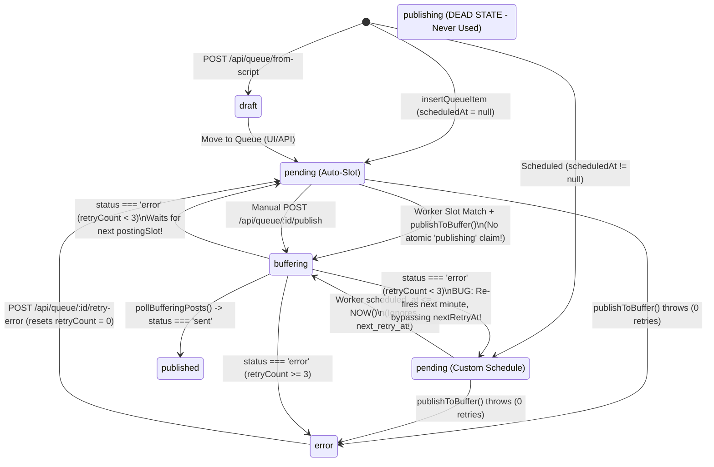
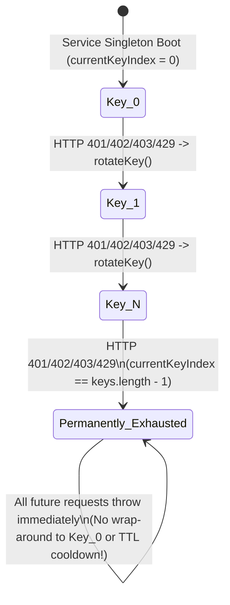
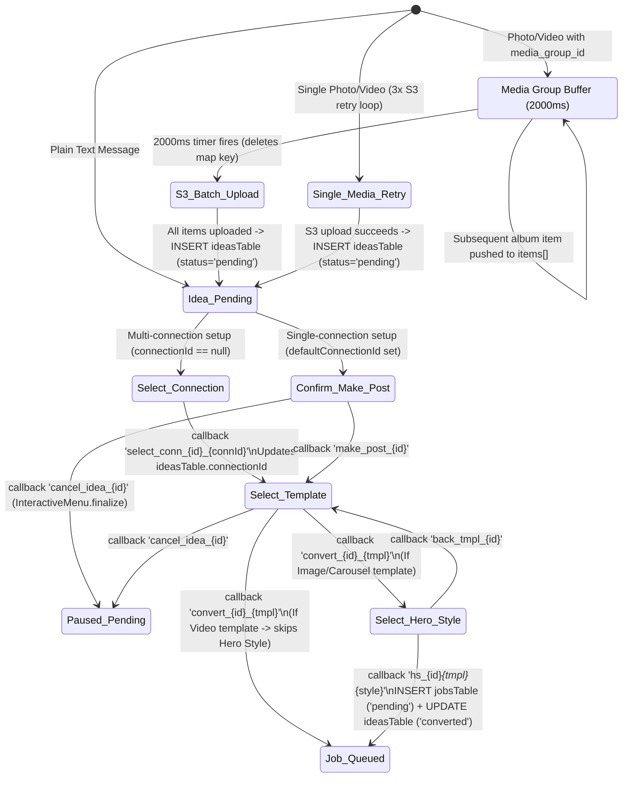
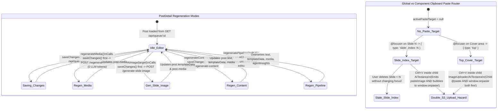

# Implicit State Machines in `ig-news-maker-bot`

## 1. Definition: What Is an Implicit State Machine (ISM)?

An **Implicit State Machine (ISM)** is any data entity, workflow, daemon loop, resource pool, or UI component whose runtime behavior depends on discrete operational states and transitions between them **without an explicit, centralized Finite State Machine (FSM) enforcement layer** (such as a state transition table, XState machine, or single guarded reducer `transition(state, event) -> nextState`).

In `ig-news-maker-bot`, state machines are encoded implicitly through five recurring patterns:
1. **Emergent Composite Database States:** String `status` columns (`'pending'`, `'processing'`, `'buffering'`, `'published'`, `'error'`, `'draft'`, `'converted'`, `'rejected'`) combined with nullable timestamp/counter columns (`scheduledAt`, `nextRetryAt`, `retryCount`, `bufferPostId`, `lastAutoPublishAt`, `connectionId`) that are read and mutated across separate processes (`bot.ts`, `worker.ts`, `server.ts`, and `frontend/`).
2. **In-Memory Conversational & Timer Maps:** Ephemeral `Map` / `Set` instances (`mediaGroupAccumulator`, `InteractiveMenu.activeTimeouts`, `pendingRequests`) and stateless Telegram `callback_data` string prefixes (`make_post_`, `select_conn_`, `convert_`, `hs_`) that encode multi-step wizard progress.
3. **Polling, Concurrency & Retry Loops:** Background cron/timeout loops (`processNextJob`, `autoPublishQueue`, `pollBufferingPosts`, `uploadMediaToGemini`) that infer state from counters (`activeJobs`, `attempt`, `currentKeyIndex`) and timestamps.
4. **Multi-Stage AI & Media Fallback Cascades:** Sequential pipelines (`runAutomatedPipeline`, `curateImages`, `imageEditor`, `imageGenerator`) where phase progression and error recovery are governed by mutable accumulators, `try/catch` degradation chains, and sentinel values (such as a `1x1` black PNG or empty string `""`).
5. **Frontend Reactive Flag Combinations:** Pinia stores and Vue component refs (`generating`, `regeneratingType`, `generatingImageKey`, `activePasteTarget`, `canUndo`, `scriptSubmittingMode`) that coordinate asynchronous client-server mutations without mutual exclusion.

---

## 2. Master Inventory of Implicit State Machines (28 ISMs)

After spidering all scripts across `src/`, `services/`, `frontend/`, and `scripts/` and filtering out stateless data transformers (e.g., pure QR Base64 encoding or static Sharp image padding), **28 genuine Implicit State Machines** were identified across **6 architectural domains**:

| ID | Domain | Implicit State Machine | State Carrier(s) | Primary Code Files | Risk Severity |
| :--- | :--- | :--- | :--- | :--- | :--- |
| **ISM-01** | DB & Queue | **Post Queue & Buffer Publishing Lifecycle** | `queueTable.status` + `scheduledAt`, `nextRetryAt`, `retryCount`, `bufferPostId`, `publishedAt` | `src/db/schema.ts`, `src/worker.ts`, `src/worker/polling.ts`, `src/server.ts`, `src/buffer.ts` | **CRITICAL** |
| **ISM-02** | DB & Queue | **Background Worker Job Lifecycle** | `jobsTable.status` (`pending`, `processing`, `completed`, `error`), `updatedAt`, `errorLog` | `src/db/schema.ts`, `src/worker.ts`, `src/server.ts`, `frontend/src/views/Jobs.vue` | **HIGH** |
| **ISM-03** | DB & Queue | **Idea Ingestion & Conversion Lifecycle** | `ideasTable.status` (`pending`, `converted`, `rejected`), `connectionId` | `src/db/schema.ts`, `src/bot.ts`, `src/server.ts`, `frontend/src/views/Ideas.vue` | **HIGH** |
| **ISM-04** | DB & Queue | **Settings Seeding & Auto-Publish Slot Cooldown** | `settingsTable.lastAutoPublishAt`, row count (`0` vs `>=1`), `postingSlots` | `src/db/settings.ts`, `src/worker.ts`, `src/utils/scheduleChecker.ts` | **MEDIUM** |
| **ISM-05** | Worker Daemon | **Worker Pool Semaphore & Idle Polling Scheduler** | `activeJobs` (`0..3`), `isShuttingDown`, `setImmediate` / `setTimeout(3000)` | `src/worker.ts` | **HIGH** |
| **ISM-06** | Worker Daemon | **Buffer Status Polling & Backoff Retry Engine** | `statusResult.status` (`sent`, `error`), `retryCount`, `nextRetryAt` | `src/worker/polling.ts`, `src/buffer.ts` | **CRITICAL** |
| **ISM-07** | Telegram Bot | **Interactive Idea-to-Job Conversion Wizard** | `callback_data` prefixes (`make_post_`, `select_conn_`, `convert_`, `hs_`, `back_tmpl_`) + `ideasTable` | `src/bot.ts`, `src/templates.ts` | **HIGH** |
| **ISM-08** | Telegram Bot | **Media Group (Album) Debounce Accumulator** | `mediaGroupAccumulator: Map<mediaGroupId, { timer, items[] }>` (2000ms window) | `src/bot.ts` | **HIGH** |
| **ISM-09** | Telegram Bot | **Interactive Menu Ephemeral Keyboard & Timeout Manager** | `InteractiveMenu.activeTimeouts: Map<chat_msg, Timeout>`, `inline_keyboard` | `src/utils/interactiveMenu.ts`, `src/bot.ts` | **LOW** |
| **ISM-10** | Telegram Bot | **Bot Launch & Media S3 Transfer Retry Loops** | `retries` counters (`10x` launch, `3x` media download/upload), `finalS3Url` | `src/bot.ts` | **LOW** |
| **ISM-11** | AI & Editorial | **Top-Level Automated Pipeline Orchestrator** | `pipelineContext`, `agentInsights`, `researchResult`, `statusMsg`, `isDirectScript` | `src/agent.ts`, `src/agents/editorial/registry.ts`, `src/agents/editorial/opinion.ts` | **MEDIUM** |
| **ISM-12** | AI & Editorial | **Multi-Turn Tool-Calling Research Agent Loop** | `stepCountIs(5)`, `attempt` (`0..3`), shared outer `candidateSources[]`, `scrapedImageUrl`, `fallbackMarkdown` | `src/agents/editorial/research.ts` | **HIGH** |
| **ISM-13** | AI & Editorial | **Exa & Firecrawl API Key Pool Rotation & Fallback** | `currentKeyIndex` (`0..keys.length-1`), `app` client instance, inner `try/catch` cascade | `src/utils/exa.ts`, `src/utils/firecrawl.ts`, `src/agents/editorial/research.ts` | **CRITICAL** |
| **ISM-14** | AI & Editorial | **Image Curator Iterative Search & Visual Deduplication** | `approvedImages[]` (with in-memory `Buffer`s), `seenUrls: Set`, `attempt`, `offset` | `src/agents/image-curator/index.ts`, `src/openserp.ts` | **MEDIUM** |
| **ISM-15** | AI & Editorial | **Placeholder-Protected Text Censorship Pipeline** | `protectedText`, `extractedUrls[]`, `__URL_PLACEHOLDER_N__`, `extractedTags[]` | `src/sanitize.ts`, `services/subtitle-maker/src/sanitize.ts`, `frontend/src/sanitize.ts` | **LOW** |
| **ISM-16** | Media Pipelines | **Dual-Mode Content Generator (Script vs Dynamic / Album)** | `isStructuredSlideScript(userInput)`, `isAlbum`, `reduceTextOnAlbum`, dynamic Zod schema | `src/agents/pipelines/image/aa.geopolitik/carousel_analysis.ts`, `src/agents/pipelines/image/poros.perjuangan/carousel_dark.ts` | **MEDIUM** |
| **ISM-17** | Media Pipelines | **Multi-Tiered Visual Sourcing & Silent Fallback Cascade** | `mode` (`4K-Enhance` / `Dark-Dramatize`), `outputBuffer`, `BLACK_FALLBACK_PNG`, `coverImageUrl` | `src/utils/imageEditor/index.ts`, `src/utils/imageGenerator/index.ts`, `src/agents/pipelines/image/**` | **HIGH** |
| **ISM-18** | Media Pipelines | **Source Article QR Slide Injection Machine** | `source_url` / `primarySourceUrl`, `sanitizeSourceUrl()`, `pages[]` array mutation | `src/agents/pipelines/image/poros.perjuangan/single_page.ts`, `carousel_dark.ts`, `carousel_multi_images.ts` | **LOW** |
| **ISM-19** | Media Pipelines | **FFmpeg Video Probing, Aspect-Ratio & Audio Merger** | `ffprobe` (`width`, `height`, `hasAudio`), `isPortraitOrSquare`, `isAlready9x16`, temp files | `src/agents/pipelines/video/poros.perjuangan/title_only.ts`, `src/media-processor.ts` | **MEDIUM** |
| **ISM-20** | Microservices | **Media-Renderer Puppeteer Lifecycle & Asset Settling** | `let marked`, `browser`, `page`, `pendingRequests: Set<string>`, `imageUrls[]` | `services/media-renderer/server.js`, `services/media-renderer/public/textFit.min.js` | **HIGH** |
| **ISM-21** | Microservices | **Subtitle-Maker Pipeline & Gemini File Polling Loop** | `fileState` (`PROCESSING`, `ACTIVE`, `FAILED`), `uploadedFileId`, `translatedMap`, `currentChunk` | `services/subtitle-maker/src/index.ts`, `src/gemini.ts`, `src/chunker.ts` | **HIGH** |
| **ISM-22** | Frontend UI | **Active Connection Store & LocalStorage Auto-Snap** | `activeConnectionId`, `connections[]`, `loadingConnections`, `localStorage` | `frontend/src/store.ts`, `frontend/src/App.vue` | **MEDIUM** |
| **ISM-23** | Frontend UI | **HTTP 401 Interception & Recursive Password Prompt** | `dashboardPassword` ref, `window.prompt()`, recursive `apiFetch()` call stack | `frontend/src/auth.ts` | **MEDIUM** |
| **ISM-24** | Frontend UI | **PostDetail Tiered Regeneration & Live Editor Machine** | `saving`, `generating`, `regeneratingType`, `generatingImageKey`, `post.templateData` | `frontend/src/views/PostDetail.vue`, `src/server.ts` | **HIGH** |
| **ISM-25** | Frontend UI | **Global Focus-Tracked Clipboard Image Paste Router** | `activePasteTarget` (`{ type: 'top' \| 'slide', index }`), `window.onpaste` + child `@paste` | `frontend/src/views/PostDetail.vue`, `frontend/src/components/AiTextarea.vue`, `ImageUploader.vue` | **MEDIUM** |
| **ISM-26** | Frontend UI | **CreatePost Multi-Tab Wizard & Job Poller** | `activeTab`, `scriptSubmittingMode` (`draft` \| `worker`), `activeJobs[]`, 5s `setInterval` | `frontend/src/views/CreatePost.vue`, `frontend/src/views/Jobs.vue` | **MEDIUM** |
| **ISM-27** | Frontend UI | **Dashboard Queue Reorder, Dual-Fetch & Slot Conflict Modal** | `queue[]`, `scheduledQueue[]`, `isPublishWarningModalOpen`, `upcomingSchedule` | `frontend/src/views/Dashboard.vue`, `src/utils/scheduleChecker.ts` | **MEDIUM** |
| **ISM-28** | Frontend UI | **AiTextarea Refinement, Censoring & Single-Slot Undo** | `isRefining`, `isCensoring`, `canUndo`, `previousText`, `lastAction` (`ai` \| `censor`) | `frontend/src/components/AiTextarea.vue` | **LOW** |

---

## 3. Top Issues Requiring Further Thought (Evaluation & Triage)

Evaluating the 28 implicit state machines reveals **10 high-priority architectural hazards** where implicit state transitions can cause duplicate social media posts, permanent service lockouts, process crashes, or silent content corruption.

### Priority 1: Broken Backoff & Duplicate Publishing in `queueTable` (ISM-01 & ISM-06)
* **Where:** `src/worker.ts:150-189`, `src/worker/polling.ts:91-110`, `src/server.ts:53-90, 749-803`, `src/db/schema.ts:30`
* **Why It Requires Thought:**
  1. **Custom Scheduled Posts Bypass Exponential Backoff:** When a post in `buffering` fails on Buffer, `pollBufferingPosts` (`src/worker/polling.ts:102-109`) demotes it back to `status = 'pending'` and sets `nextRetryAt = NOW() + 2^(retryCount + 1) minutes`. However, for custom scheduled posts (`scheduled_at IS NOT NULL`), `autoPublishQueue` in `src/worker.ts:151-153` queries `WHERE status = 'pending' AND scheduled_at IS NOT NULL AND scheduled_at <= NOW()` **without checking `next_retry_at`**. On the very next 60-second tick, the worker ignores `nextRetryAt` and immediately re-publishes the failed post, burning all 3 retries in 3 minutes.
  2. **Auto-Queue Retries Are Locked Behind Posting Slots:** Conversely, when an auto-queue post (`scheduled_at IS NULL`) is demoted to `pending` with `nextRetryAt`, `src/worker.ts:212-230` only checks the queue when the current minute matches a configured `postingSlots` entry (`slot.day === day && slot.time === currentTimeStr`). Once that minute passes, `nextRetryAt` is never evaluated until the next scheduled slot (hours or days later).
  3. **Unused `'publishing'` Lock State & Double-Publish Race:** `src/db/schema.ts:30` documents `'publishing'` as a status, but **nothing in the codebase ever sets `status = 'publishing'`**. Both `worker.ts` and `server.ts` (`POST /api/queue/:id/publish`) read the row while `status = 'pending'`, await the external `publishToBuffer()` network call, and only afterward update `status = 'buffering'`. Concurrent triggers (or worker + manual click) will publish the same post twice to Instagram.

### Priority 2: Permanent One-Way Exhaustion & Race in API Key Rotation (ISM-13)
* **Where:** `src/utils/exa.ts:11-42`, `src/utils/firecrawl.ts:3-34`
* **Why It Requires Thought:**
  - `ExaService` and `FirecrawlService` are process-wide singletons that advance `this.currentKeyIndex++` whenever a 401/402/403/429 error occurs (`if (this.currentKeyIndex < this.keys.length - 1)`).
  - **No Wrap-Around or Cooldown Reset:** Once `currentKeyIndex` reaches `keys.length - 1` and experiences a transient 429 rate-limit burst, `rotateKey()` returns `false` forever. Even after rate-limit windows reset on earlier keys (indices `0..N-2`), the service is **permanently bricked** until the Node process restarts.
  - **Concurrent Double-Increment:** When 3 worker jobs run in parallel (`MAX_CONCURRENT_JOBS = 3`) and hit a rate limit on key `0` simultaneously, all three call `rotateKey()`, advancing `currentKeyIndex` from `0 -> 1 -> 2 -> 3` and skipping valid keys without using them.

### Priority 3: Worker Timer Avalanche & Zombie `'processing'` Jobs (ISM-02 & ISM-05)
* **Where:** `src/worker.ts:32-138`, `src/server.ts:477-495`
* **Why It Requires Thought:**
  1. **Timer Multiplication Avalanche:** At startup (`src/worker.ts:136-138`), the worker schedules 3 staggered calls to `processNextJob()`. Whenever a call finds an empty queue and `activeJobs === 0` (`src/worker.ts:59-61`), it registers `setTimeout(processNextJob, 3000)`. Because all 3 initial chains (plus chains spawned via `setImmediate(processNextJob)` at line 71 AND line 130) converge to `activeJobs === 0`, multiple concurrent 3-second polling chains accumulate in the event loop.
  2. **Zombie `'processing'` Jobs:** `processNextJob()` claims jobs via `UPDATE jobs SET status = 'processing' ... WHERE status = 'pending' FOR UPDATE SKIP LOCKED`. If the worker container restarts, crashes, or hits an OOM during FFmpeg/AI execution, any job in `'processing'` stays in `'processing'` forever—there is no startup sweep or stale `updated_at` recovery query.

### Priority 4: Telegram Album `TypeError` Crash & Non-Atomic Wizard Conversion (ISM-07 & ISM-08)
* **Where:** `src/bot.ts:336-412, 468-590`
* **Why It Requires Thought:**
  1. **Album Timer vs. Late Message Race:** In `src/bot.ts:338-403`, a 2000ms `setTimeout` is created when the first photo/video of a Telegram album arrives. Line 402 immediately executes `const group = mediaGroupAccumulator.get(mediaGroupId)!; group.items.push(...)`. Furthermore, if an album has >2 seconds of delivery jitter across Telegram's CDN, the first timer fires and deletes the map entry, splitting a single user album into two separate `ideasTable` records.
  2. **Double Job Creation on Rapid Button Tap:** In `src/bot.ts:494-590` (`convert_` and `hs_` handlers) and `src/server.ts:420-445` (`POST /api/ideas/:id/convert`), the check `if (idea.status !== 'pending')` is a plain `SELECT` followed later by `INSERT INTO jobs` and `UPDATE ideas SET status = 'converted'`. Double-tapping the Telegram inline button or Web UI button before the first DB write finishes queues duplicate AI generation jobs.

### Priority 5: Research Agent Retry Accumulator Contamination & `"undefined"` Tool Output (ISM-12)
* **Where:** `src/agents/editorial/research.ts:190-375`
* **Why It Requires Thought:**
  - `candidateSources`, `scrapedImageUrls`, `scrapedImageUrl`, and `fallbackMarkdown` are declared **outside** the `while (attempt < maxRetries)` loop (`src/agents/editorial/research.ts:190-195`). If Attempt 1 executes 3 tool calls and then fails on step 4, Attempt 2 starts with dirty accumulators from Attempt 1.
  - Inside `searchWeb` (`src/agents/editorial/research.ts:272`), if Exa fails and Firecrawl returns `undefined` or fails silently, `JSON.stringify(res)` returns the literal JavaScript value `undefined` to the AI SDK tool result, causing the LLM to either fail schema validation or hallucinate.
  - `scrapedImageUrl` (`src/agents/editorial/research.ts:303, 335`) is a single scalar variable overwritten by whichever `scrapeUrl` tool call runs last, clobbering the primary article's hero image with secondary reference link images.

### Priority 6: Silent Quality Degradation & `1x1` Black Pixel Fallbacks in Media Pipelines (ISM-17)
* **Where:** `src/utils/imageGenerator/index.ts:109-115`, `src/utils/imageEditor/index.ts:220-224, 332-336`, `src/agents/pipelines/image/poros.perjuangan/carousel_multi_images.ts:242-246`
* **Why It Requires Thought:**
  - When `imageGenerator` exhausts retries (e.g., Gemini quota or safety block), it does **not** throw; instead, it uploads a **1x1 black PNG** (`BLACK_FALLBACK_PNG`) to S3 and returns a valid S3 URL (`src/utils/imageGenerator/index.ts:109-122`).
  - Because `imageGenerator` swallows the error and returns a valid URL, the `try/catch` fallback blocks in `carousel_analysis.ts:237` (which intended to fall back to `coverImageUrl` on generator failure) and `carousel_multi_images.ts:238` **never trigger**! Instead, the pipeline renders slides with a stretched 1x1 black pixel background and queues the post as ready to publish.

### Priority 7: Media-Renderer Sequential Browser Thrashing & Unawaited `marked` Import (ISM-20)
* **Where:** `services/media-renderer/server.js:8-18, 142-162, 222-226`
* **Why It Requires Thought:**
  1. **Per-Slide Browser Process Spawning:** In `POST /render/:mediaType/:brand/:templateName` (`server.js:222-226`), `renderHtmlToBuffer` calls `puppeteer.launch()` and `browser.close()` **inside the `for` loop for every single slide**. Rendering an 8-slide carousel launches and tears down 8 full Chromium browser instances sequentially.
  2. **Startup Race on `import('marked')`:** `server.js:9` fires an top-level unawaited `import('marked').then(...)` while `app.listen()` starts immediately. Any render request arriving right as the container boots will invoke `marked.parse()` while `marked` is still `undefined`.
  3. **Duplicate Asset URL Set Collision:** `pendingRequests` is a `Set<string>` keyed by URL (`server.js:61, 147`). If a slide loads two elements referencing the same URL, the first `requestfinished` event deletes the URL from the `Set` while the second request is still downloading.

### Priority 8: Subtitle-Maker Infinite Polling & Leaked Gemini Cloud Files (ISM-21)
* **Where:** `services/subtitle-maker/src/gemini.ts:49-71`, `services/subtitle-maker/src/index.ts:56-108`, `services/subtitle-maker/src/chunker.ts:95-100`
* **Why It Requires Thought:**
  1. **Unbounded Polling Loop:** `while (fileState === 'PROCESSING')` (`gemini.ts:56-62`) polls `ai.files.get()` every 3 seconds with **no maximum timeout or attempt counter**.
  2. **Leaked Gemini Cloud Storage on `FAILED` State:** If `fileState === 'FAILED'` (`gemini.ts:64`), `uploadMediaToGemini` throws before returning `uploadResponse`. Consequently, `uploadedMedia` in `index.ts:56` remains `null`, and `finally { if (uploadedMedia) await deleteMediaFromGemini(...) }` (`index.ts:104`) never cleans up the remote file.
  3. **Aggressive Gap Elimination Freezes Subtitles Across Music/Silence:** `buildSRT` (`chunker.ts:95-100`) unconditionally sets `processed[i].end = processed[i + 1].start`. If there is a 30-second instrumental/visual break between two spoken sentences, the previous subtitle stays frozen on screen for the entire 30 seconds.

### Priority 9: Schedule Checker Midnight Rollover Blind Spot (ISM-04 & ISM-27)
* **Where:** `src/utils/scheduleChecker.ts:90-145`
* **Why It Requires Thought:**
  - `checkUpcomingSchedule` converts the current time and each `postingSlots` entry in the same `currentDay` into minutes since `00:00` (`slotTotalMins - currentTotalMins`) and checks `if (diff > 0 && diff <= windowMinutes)`.
  - If an operator clicks "Publish Now" at `23:30 WIB` and there is an auto-publish slot at `00:15 WIB` (45 minutes away, on the next weekday), `scheduleChecker` only checks `currentDay` and computes negative `diff` values across midnight, completely missing the conflict.

### Priority 10: Frontend `PostDetail.vue` Unsaved Edit Loss & Double Clipboard Upload (ISM-24 & ISM-25)
* **Where:** `frontend/src/views/PostDetail.vue:194-227, 290-385`, `frontend/src/components/AiTextarea.vue:20-33`, `frontend/src/components/ImageUploader.vue:26-38`
* **Why It Requires Thought:**
  1. **Inconsistent Pre-Save in Tiered Regeneration:** In `PostDetail.vue`, `regenerateMedia()` (line 291), `generateAiImage()` (line 310), and `regenerateContent()` (line 339) all call `await saveChanges()` before hitting the backend. However, `regeneratePipeline()` (line 361) **omits `await saveChanges()`** and does not lock form inputs while `generating = true`, silently wiping any unsaved edits in the form.
  2. **Event Bubbling Triggers Double S3 Uploads on Image Paste:** When a user presses `Ctrl+V` with an image while focused inside an `AiTextarea` or `ImageUploader` on `PostDetail.vue`, both the component's `@paste` handler and `window.addEventListener('paste', onGlobalPaste)` fire without `event.stopPropagation()`, uploading the same clipboard image to S3 twice.

---

## 4. Detailed Domain-by-Domain Reference & State Diagrams

### Domain A: Core Database & Worker Queue Lifecycles (ISM-01 to ISM-06)

#### ISM-01 & ISM-06: Post Queue (`queueTable`) & Buffer Polling State Machine
* **Files:** `src/db/schema.ts:24-41`, `src/db/queue.ts:5-40`, `src/worker.ts:142-269`, `src/worker/polling.ts:16-147`, `src/server.ts:53-90, 645-910`, `src/buffer.ts:48-200`
* **State Carriers:**
  - `queueTable.status`: `'draft' | 'pending' | 'publishing' | 'buffering' | 'published' | 'error'`
  - `queueTable.scheduledAt`: Distinguishes **Auto-Slot Queue** (`NULL`) from **Custom Scheduled Queue** (`NOT NULL`).
  - `queueTable.retryCount` (`0..3`) & `queueTable.nextRetryAt` (exponential backoff timestamp: $2^{\text{retryCount}+1}$ minutes).
  - `queueTable.bufferPostId` & `queueTable.postUrl`.
* **Transition Table:**

| From State | Event / Trigger | Guard Condition | To State | Side Effects & Mutations |
| :--- | :--- | :--- | :--- | :--- |
| `(none)` | `POST /api/queue/from-script` | `saveAsDraft === true` | `draft` | Inserts row with `sortOrder = max + 10` |
| `(none)` | Pipeline / `POST /api/queue` | Default | `pending` | Inserts row (`scheduledAt = null` or user date) |
| `draft` | `PUT /api/queue/:id` | User clicks "Move to Queue" | `pending` | Updates `status = 'pending'` |
| `pending` | `autoPublishQueue` (Custom) | `scheduled_at <= NOW()` | `buffering` | Calls `publishToBuffer()`, sets `bufferPostId` |
| `pending` | `autoPublishQueue` (Slot) | `scheduled_at IS NULL` & slot match & `next_retry_at <= NOW()` & `diffMins >= 1` | `buffering` | Calls `publishToBuffer()`, updates `lastAutoPublishAt` (twice!) |
| `pending` | `POST /api/queue/:id/publish` | Manual trigger | `buffering` | Calls `publishToBuffer()`, sets `publishedAt = NOW()` prematurely |
| `pending` | `publishToBuffer()` throws | Network / GraphQL error | `error` | Sets `errorLog` immediately (0 retries) |
| `buffering` | `pollBufferingPosts` (20s) | `Buffer.status === 'sent'` & `externalLink` | `published` | Sets `postUrl`, `publishedAt = NOW()`, sends Telegram alert |
| `buffering` | `pollBufferingPosts` (20s) | `Buffer.status === 'error'` & `retryCount < 3` | `pending` | Sets `retryCount++`, `nextRetryAt = NOW() + 2^(n+1)m` |
| `buffering` | `pollBufferingPosts` (20s) | `Buffer.status === 'error'` & `retryCount >= 3` | `error` | Sets `errorLog`, sends Telegram failure alert |
| `error` | `POST /api/queue/:id/retry-error` | Manual retry | `pending` | Resets `retryCount = 0`, `nextRetryAt = null`, `errorLog = null` |

---

#### ISM-02 & ISM-05: Background Job Queue (`jobsTable`) & Worker Concurrency Pool
* **Files:** `src/db/schema.ts:52-63`, `src/worker.ts:32-138`, `src/server.ts:200-230, 462-510`
* **State Carriers:**
  - DB: `jobsTable.status` (`'pending' | 'processing' | 'completed' | 'error'`), `updatedAt`, `errorLog`.
  - Memory: `activeJobs` (`0..3`), `isShuttingDown` (`boolean`).

```mermaid
stateDiagram-v2
    state "Worker Daemon Loop (src/worker.ts)" as WorkerLoop {
        [*] --> Spawning : Boot (3x staggered setTimeout 0ms, 500ms, 1000ms)
        Spawning --> Claiming : processNextJob() (if !isShuttingDown && activeJobs < 3)
        Claiming --> IdleWait : 0 rows returned & activeJobs == 0\nsetTimeout(processNextJob, 3000)
        IdleWait --> Claiming : 3000ms timer fires
        Claiming --> ExecutingJob : Row claimed via FOR UPDATE SKIP LOCKED\nactiveJobs++ (if activeJobs < 3 -> setImmediate)
        ExecutingJob --> Claiming : finally { activeJobs--; setImmediate(processNextJob) }
        Claiming --> ShuttingDown : SIGINT / SIGTERM (isShuttingDown = true)
    }

    state "Database Job Row (jobsTable)" as JobRow {
        [*] --> pending : Created via Bot Wizard or POST /api/generate-content
        pending --> processing : Worker claims row (FOR UPDATE SKIP LOCKED)
        processing --> completed : runAutomatedPipeline() resolves
        processing --> error : runAutomatedPipeline() throws
        processing --> Zombie_Processing : Worker process killed/OOM (NO RECOVERY!)
        error --> pending : POST /api/jobs/:id/retry (errorLog = null)
    }
```

---

### Domain B: Telegram Bot & Conversational Workflows (ISM-07 to ISM-10)

#### ISM-07 & ISM-08: Media Group Accumulator & Callback Conversion Wizard
* **Files:** `src/bot.ts:50-51, 91-236, 258-597`, `src/utils/interactiveMenu.ts:8-177`
* **State Carriers:**
  - `mediaGroupAccumulator`: `Map<string, { timer: NodeJS.Timeout, items: Array<...> }>`
  - `InteractiveMenu.activeTimeouts`: `Map<string, NodeJS.Timeout>`
  - `ideasTable`: `status` (`'pending' | 'converted' | 'rejected'`), `connectionId`
  - Callback query data payload (`<= 64 bytes`): `make_post_${id}`, `select_conn_${id}_${connId}`, `convert_${id}_${shortCode}`, `hs_${id}_${shortCode}_${styleCode}`, `back_tmpl_${id}`, `cancel_idea_${id}`

---

### Domain C: AI Research, Editorial & Content Generation Pipelines (ISM-11 to ISM-19)

#### ISM-11, ISM-12, ISM-16 & ISM-17: End-to-End Content & Visual Generation Pipeline
* **Files:**
  - Orchestration: `src/agent.ts:10-88`, `src/agents/editorial/research.ts:37-435`, `src/agents/editorial/opinion.ts:31-147`
  - Pipelines: `src/agents/pipelines/image/aa.geopolitik/carousel_analysis.ts`, `src/agents/pipelines/image/poros.perjuangan/carousel_dark.ts`, `carousel_multi_images.ts`, `single_page.ts`, `src/agents/pipelines/video/poros.perjuangan/title_only.ts`
  - Image Agents: `src/agents/image-curator/index.ts`, `src/utils/imageEditor/index.ts`, `src/utils/imageGenerator/index.ts`

```mermaid
stateDiagram-v2
    [*] --> Evaluate_Input : runAutomatedPipeline()
    Evaluate_Input --> Media_Only_Bypass : template.skipResearch || isStructuredSlideScript(input)
    Evaluate_Input --> Research_Loop : Standard Topic / URL Input

    state "Research Agent Loop (maxRetries=3, stepCountIs=5)" as Research_Loop {
        [*] --> LLM_Tool_Step
        LLM_Tool_Step --> Exa_Primary : tool 'searchWeb' / 'scrapeUrl'
        Exa_Primary --> Firecrawl_Fallback : Exa throws / quota exhausted
        Exa_Primary --> Mutate_Accumulators : Appends candidateSources[], overwrites scrapedImageUrl
        Firecrawl_Fallback --> Mutate_Accumulators : Appends fallbackMarkdown, ogImage
        Mutate_Accumulators --> LLM_Tool_Step : Next tool step (up to 5)
        LLM_Tool_Step --> Raw_Markdown_Fallback : All 3 LLM retries return empty text
    }

    Media_Only_Bypass --> Opinion_Gate : processedMedia uploaded to S3
    Research_Loop --> Opinion_Gate : agentInsights.research populated

    Opinion_Gate --> Opinion_Loop : !isDirectScript && requiresOpinion && researchText != ''
    Opinion_Gate --> Template_Pipeline : Bypass opinion (Direct Script or not required)

    state "Opinion Phase (maxRetries=3)" as Opinion_Loop {
        [*] --> Generate_Stance
        Generate_Stance --> Hardcoded_Thesis_Fallback : 3 retries fail
        Generate_Stance --> Censor_Opinion : Success
        Hardcoded_Thesis_Fallback --> Censor_Opinion
    }

    Opinion_Loop --> Template_Pipeline : agentInsights.opinion populated

    state "Template & Visual Fallback Cascade" as Template_Pipeline {
        [*] --> Mode_Switch
        Mode_Switch --> Verbatim_Script_Schema : isStructuredSlideScript == true (1..16 slides)
        Mode_Switch --> Dynamic_Essay_Schema : isStructuredSlideScript == false (fixed N slides)
        Verbatim_Script_Schema --> Visual_Cascade
        Dynamic_Essay_Schema --> Visual_Cascade

        state "Per-Cover / Per-Slide Image Sourcing" as Visual_Cascade {
            [*] --> Try_User_Buffer
            Try_User_Buffer --> Try_Scraped_Or_Curated_Web : No user image
            Try_Scraped_Or_Curated_Web --> Try_Gemini_Image_Model : No web image found
            Try_Gemini_Image_Model --> Silent_Degraded_Fallback : Retries exhausted!\nReturns unedited buffer, coverImageUrl, or 1x1 BLACK_FALLBACK_PNG
        }

        Visual_Cascade --> Highlight_And_Censor : Gemini Flash-Lite bolding + censorText()
        Highlight_And_Censor --> Inject_QR_Slide : If sanitizeSourceUrl(source_url) valid -> append source_qr page
        Inject_QR_Slide --> Media_Renderer_Call : POST /render/... -> S3 URLs -> insertQueueItem('pending')
    }
```

---

### Domain D: Microservices (`media-renderer` & `subtitle-maker`) (ISM-20 & ISM-21)

#### ISM-20: `media-renderer` Request & Browser Lifecycle (`services/media-renderer/server.js`)
* **State Carriers:**
  - Module scope: `let marked` (unawaited async dynamic import at line 9).
  - Per-slide scope: `browser`, `page`, `pendingRequests: Set<string>`, `imageUrls: string[]`.
* **Key Lifecycle Flow:**
  1. Server starts with `marked = undefined` until `import('marked')` resolves and registers Handlebars helpers `markdown` and `markdownInline`.
  2. On `POST /render/:mediaType/:brand/:templateName`, iterates `for (let i = 0; i < pages.length; i++)`:
     - Resolves `templates/${templateName}/${page.file}.html` or falls back to `templates/${mediaType}/${brand}/common/${page.file}.html`.
     - Inspects first 2 bytes for UTF-16LE BOM (`0xFF 0xFE`); decodes as `utf16le` or `utf8`.
     - Rewrites CDN `textFit.min.js` URLs to `http://localhost:${port}/textFit.min.js`.
     - Launches a **new Chromium instance** via `puppeteer.launch()`, tracks network requests in `pendingRequests: Set<string>`, waits up to 15s for `networkidle0` (swallowing timeouts), executes synchronous binary-search DOM font fitting (`textFit.min.js`), captures PNG buffer, closes browser, and uploads PNG to S3.

#### ISM-21: `subtitle-maker` Transcription, Gemini Upload Polling & SRT Chunker (`services/subtitle-maker/src/`)
* **Files:** `services/subtitle-maker/src/index.ts:31-110`, `src/gemini.ts:49-157`, `src/chunker.ts:10-113`

```mermaid
stateDiagram-v2
    [*] --> Multer_Temp_File : POST /process (writes to temp/ or reads shared volume path)
    Multer_Temp_File --> ElevenLabs_Transcribe : transcribeAudio() -> words[] + audioLang
    ElevenLabs_Transcribe --> Word_Chunking : chunkWords() splits on gap > 1.0s, duration > 3.0s, chars > 40, or [?!.]

    Word_Chunking --> Skip_Translation : audioLang.slice(0,2) == targetLanguage.slice(0,2)
    Word_Chunking --> Upload_To_Gemini : Languages differ

    state "Gemini File State Polling (src/gemini.ts)" as Upload_To_Gemini {
        [*] --> PROCESSING : ai.files.upload()
        PROCESSING --> PROCESSING : Sleep 3000ms + ai.files.get() (UNBOUNDED LOOP!)
        PROCESSING --> ACTIVE : fileState !== 'PROCESSING'
        PROCESSING --> FAILED_LEAK : fileState === 'FAILED' -> throws Error\n(uploadedMedia stays null; remote file never deleted!)
         [*] --> Degraded_Null_Media : Upload exception caught -> uploadedMedia = null
    }

    ACTIVE --> Translate_Chunks : translateChunks() with video context
    Degraded_Null_Media --> Translate_Chunks : translateChunks() text-only
    Translate_Chunks --> Censor_And_Build_SRT : Maps translatedMap[chunk.id] (falls back to originalText if ID omitted)
    Skip_Translation --> Censor_And_Build_SRT

    state "SRT Merge & Gap Elimination (src/chunker.ts)" as Censor_And_Build_SRT {
        [*] --> Merge_Single_Words : If wordCount == 1 & processed.length > 0 -> merge into previous chunk
        Merge_Single_Words --> Eliminate_Gaps : processed[i].end = processed[i+1].start (freezes across long silences!)
        Eliminate_Gaps --> Cleanup_Resources : finally { deleteMediaFromGemini(); fs.unlinkSync(req.file.path); }
    }
```

---

### Domain E: Frontend Reactive UI & Client-Server Sync (ISM-22 to ISM-28)

#### ISM-24 & ISM-25: `PostDetail.vue` Tiered Regeneration & Clipboard Paste Router
* **Files:** `frontend/src/views/PostDetail.vue`, `frontend/src/components/AiTextarea.vue`, `frontend/src/components/ImageUploader.vue`

---

## 5. Summary of Actionable Recommendations

If we want to harden or refactor any of these implicit state machines, the highest-leverage improvements are:

1. **Unify `queueTable` State Transitions & Fix Retry Queries (`src/worker.ts`, `src/worker/polling.ts`, `src/server.ts`):**
   - Atomically claim posts into `status = 'publishing'` using `UPDATE queue SET status = 'publishing' WHERE id = ... AND status = 'pending' RETURNING *` before calling `publishToBuffer()`.
   - Add `AND (next_retry_at IS NULL OR next_retry_at <= NOW())` to the custom scheduled query in `src/worker.ts:153`.
   - Remove the duplicate `db.update(settingsTable).set({ lastAutoPublishAt: new Date() })` call in `src/worker.ts:216-218`.
2. **Make `ExaService` and `FirecrawlService` Key Rotation Resilient (`src/utils/exa.ts`, `src/utils/firecrawl.ts`):**
   - Use modular wrap-around (`(this.currentKeyIndex + 1) % this.keys.length`) with a per-key cooldown timestamp (`cooldownUntil: Map<number, number>`) instead of permanently halting at `keys.length - 1`.
3. **Fix Worker Polling Timer Multiplication & Stale `'processing'` Jobs (`src/worker.ts`):**
   - Guard the idle `setTimeout(processNextJob, 3000)` with a single `pollTimer: NodeJS.Timeout | null` reference so at most one idle timer exists at any time.
   - Add a startup/periodic recovery query resetting `status = 'processing'` jobs older than e.g. 15 minutes back to `'pending'` or `'error'`.
4. **Reset Research Accumulators per Attempt & Stop Silent `1x1` Black PNG Masquerading (`src/agents/editorial/research.ts`, `src/utils/imageGenerator/index.ts`):**
   - Move `candidateSources`, `scrapedImageUrls`, `scrapedImageUrl`, and `fallbackMarkdown` initialization **inside** the `while (attempt < maxRetries)` loop.
   - Have `imageGenerator` either throw or set an explicit `isFallback: true` flag when returning `BLACK_FALLBACK_PNG` so callers (`carousel_analysis.ts`, `carousel_multi_images.ts`) can fall back to `coverImageUrl` instead of rendering a black square.
5. **Reuse a Warm Browser in `media-renderer` & Bound `subtitle-maker` Polling (`services/media-renderer/server.js`, `services/subtitle-maker/src/gemini.ts`):**
   - Share a singleton Puppeteer `Browser` instance across slides in a batch (opening/closing only `page` per slide), and `await import('marked')` before `app.listen()`.
   - Add a max poll count (e.g. 60 attempts = 3 minutes) to `while (fileState === 'PROCESSING')` and delete failed Gemini files before throwing.
6. **Guard `PostDetail.vue` Pipeline Regeneration & Stop Paste Event Bubbling (`frontend/src/views/PostDetail.vue`, `frontend/src/components/AiTextarea.vue`):**
   - Call `await saveChanges()` at the start of `regeneratePipeline()` (matching `regenerateContent` and `regenerateMedia`), and call `e.stopPropagation()` in `AiTextarea.vue` / `ImageUploader.vue` paste handlers.
